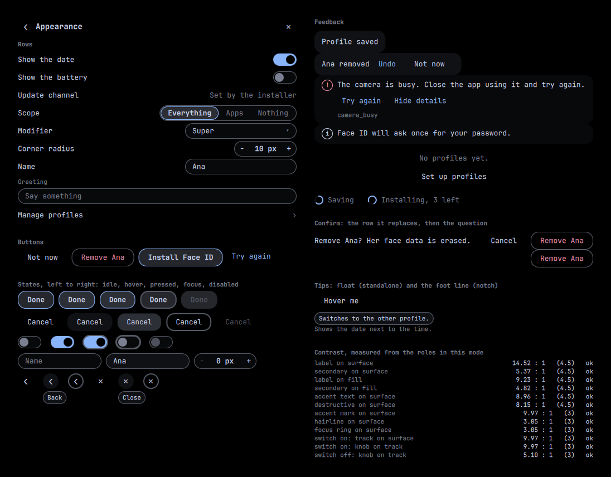
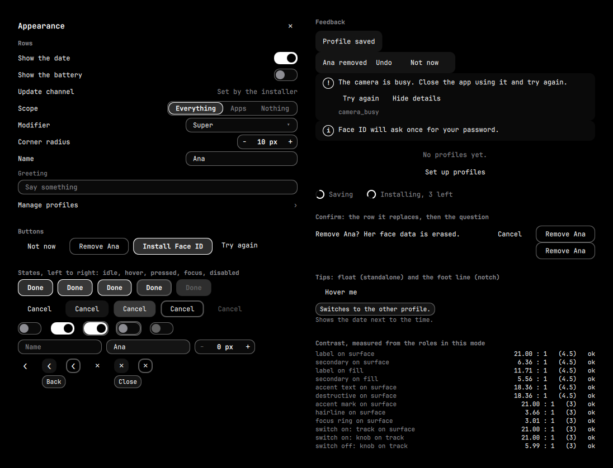

# omarchy-ui

The shared UI kit for the kalinewb Omarchy plugins (notch, profiles, face, corners, egpu): one set of tokens, motion and controls, so every plugin looks and behaves the same. One back, one close, three dismiss words, one switch, one confirm, one key map.

Not a plugin: there is no `manifest.json`, and it is never listed or installable. Each plugin **copies `ui/` into its own repo** (no symlinks, no cross-plugin imports, installs stay one `git clone`) with `dev/sync-ui.sh`. MIT.

Status: **Phase 0** of `plan-apple-ui.md` (kit and gate, no plugin migrated). The gallery below is the look the plugins will adopt; it waits for approval.



## Using it

```sh
# in a plugin repo, once, with a local checkout of this repo beside it
../omarchy-ui/dev/sync-ui.sh --from ../omarchy-ui --tools          # all of ui/, and the gate's scripts
../omarchy-ui/dev/sync-ui.sh --from ../omarchy-ui --only UButton,URow,USwitch   # or a subset (what they use comes too)
./dev/check-ui.sh --walk Panel.qml                                 # the gate, with the walk on this root
```

```qml
import "ui"

Item {                                   // the plugin's root
  UTheme { id: theme; host: surfaceHost }   // once; host is null for a standalone window
  UKeys {                                    // the one place Esc is handled
    anchors.fill: parent; focus: true
    level: "back"; open: depth > 0; onEscaped: goBack(); onCloseRequested: root.closeRequested()
    URow { theme: theme; label: "Show the date"; USwitch { theme: theme; label: "Show the date"; checked: on; onToggled: on = !on } }
  }
}
```

`UTheme` is not a singleton (a singleton cannot see a plugin's `surfaceHost`); it is passed down as `theme: theme`, and every component declares `required property var theme` and reads nothing else. The `U` prefix is mandatory: a bare `Row`, `Button` or `Switch` collides with QtQuick, QtQuick.Controls and `qs.Ui`, where the last import wins.

`ui/KIT` (written by the sync, never by hand) holds `omarchy-ui <40-hex sha of the checkout's HEAD>`, `major <n>`, and a sha256 per copied file. `dev/check-ui.sh` fails if a listed file was edited or an unlisted file sits in `ui/`: a fix goes here, then a re-sync. The sync is copy-only: it never clones, fetches or pulls, and never runs anything from the checkout, so the marketplace scanner has nothing to ask about (`dev/test.sh` runs the scanner on a fixture with and without it). It refuses a checkout with uncommitted changes under `ui/` or `dev/`, so the sha always describes what was copied.

## Three modes

| mode | when | colour |
|---|---|---|
| **standalone** | `host` is null | Omarchy's palette (`Commons.Color`), alpha fills |
| **hosted-opaque** | `host` set, `host.styled` not true (surface contract 1) | only what the notch hands over (`color`, `foreground`, `secondary`, `accent`), every colour a computed **solid**: never a translucent item, gradient or blur |
| **styled** | `host.styled === true` (contract 2) | the kit's own roles and alpha fills over the host's surface; when the notch's guard falls back, `styled` goes false and the same bindings give hosted-opaque by themselves |

`host` is any `surfaceHost`-shaped object (`color`, `foreground`, `secondary`, `accent`, `radiusFor(size)`, `fontFamily`, optionally `styled`, `reducedMotion`). Density follows: **notch** rows are 30 px with 12 px body, **standalone** 32 px with 13.



## What is in `ui/`

| class | component | |
|---|---|---|
| Back | `UBack` | chevron left of the title, "Back" tooltip and name. In the notch the back step is the existing top-middle strip, so this is not drawn there |
| Close | `UClose` | the one `✕`, top-right |
| Buttons | `UButton` | `primary` (one per surface), `quiet`, `destructive` (verb + object, last, never default), `link` (the `flow` variant) |
| Switch | `USwitch` | 22 x 42 track in a 24 px target |
| Pick | `USegmented` (2 to 4), `UPick` (3 or more) | |
| Field | `UField` (Enter commits, Esc reverts), `UStepper` (`-` / `+`, Left / Right) | |
| Row, section | `URow` (`row` and `stacked`, a `trailing` slot), `USection` | |
| Tip | `UTip` | `float` (a box) or `foot` (one reserved line, no box) |
| Toast, error | `UToast`, `UNotice` | a code never reaches the surface; unknown codes read "Something went wrong." |
| Empty, progress | `UEmpty`, `URing` | the ring is determinate or indeterminate, and holds still under reduced motion |
| Confirm | `UConfirmSheet` | an inline row that replaces the action row, never an overlay |
| Keys | `UKeys`, `keys.js` | Esc closes, in order: an edit, a tip, an open pick, a modal, then goes back, then closes |
| | `UTheme`, `tokens.js`, `spring.js`, `errors.js` | roles, density and motion; the springs; one error table per plugin |

**Dismiss words** are three: **Cancel** (abandon), **Done** (finish), **Not now** (defer). "Close", "Keep", "Later", "Dismiss", "OK" and "Okay" are out. Action verbs are an open set and are not dismiss words ("Remove Ana", "Install Face ID"), plus the named recoveries "Try again" and "Undo".

**Colour.** Text is held to 4.5:1 and every mark (a border, ring, track, knob or arc, each declaring `uiMark: true`) to 3:1, in every mode, on every host: `tokens.js` repairs what it is handed with `lift` (the host's `lift` of `plan-surface-v2.md`, same vectors) and caps each fill so the text on it keeps its floor. Hairlines and the focus ring are raised to 3:1 (a 25 % ring is about 1.6:1 on black). `contrast` is the one WCAG body that `Bar.qml` in omarchy-notch has; the test compares them. Destructive is red only where the panel owns its colours.

**Motion.** `arrive` 0.72 / 0.6 / 350 ms (anything that grows; 3.8 % overshoot), `control` 0.85 / 0.55 / 200 ms, `celebrate` 0.60 / 450 ms (one use), `exit` OutCubic 180 ms, `fade` out 90 / in 150, `press` scale 0.97 over 60 ms, `stagger` 40 ms capped at 240. Springs only for what arrives; never on a colour or an opacity.

### Reduced motion

`OMARCHY_REDUCED_MOTION=1` in the environment turns reduced motion on; `NOTCH_REDUCED_MOTION=1` is an alias that the notch (`Bar.reducedMotion`) and `UTheme` both read; a host may provide `reducedMotion` instead. (`OMARCHY_` is only a prefix: it is not an Omarchy variable and this section is its one definition. Copy it into each plugin's README.) When on: springs are off, `press` and `stagger` are off, fades stay (they carry no movement), loops stop and show their final frame (the indeterminate ring is a steady half arc).

## Checking

```sh
./dev/test.sh              # everything: lint, node tests, behaviour tests, the walk's and the gate's self-tests, sync, scanner, gallery
./dev/test.sh --quick      # lint and node only
./dev/gallery.sh           # render the gallery in every mode to docs/gallery/*.png and print the contrast table
./dev/gallery.sh --live    # open it in a real window
./dev/check-ui.sh --score  # the consistency gate and score, on this repo or  --repo <dir> --ref <sha>
./dev/baseline.sh          # the five plugins' baselines
```

- `dev/tests/*.mjs` (node): `keys.js` (the key map and Esc order), `tokens.js` (every role pair in every mode on 16 hosts and on all 51 installed themes, `lift`, the one contrast body), `spring.js` (`Spring.overshoot` and the sampled curves), `errors.js`, and the kit's shape.
- `dev/tests/qml/tst_kit.qml` (`qmltestrunner`, a stub theme): real key presses through the components, including the full Esc order.
- `dev/gallery.qml` is every component in every state on one sheet; `dev/harness/ui-gallery.qml` renders it with a fake `surfaceHost` (radius 10, black or white) offscreen (`QT_QPA_PLATFORM=offscreen`, OpenGL RHI, as omarchy-notch `dev/glow.sh`).
- `dev/harness/ui-walk.qml` walks a root's `children` and checks names, 24 px targets, 11 px text, text contrast **measured from rendered pixels**, loops under reduced motion, and no translucent item in hosted-opaque mode. `dev/check-ui.sh` runs it in seven configurations.

The gate (`dev/check-ui.sh`) fails on: a hand-edited `ui/`; a type in `ui/` not starting with `U`; outside `ui/`, `pixelSize: <digit>`, `"#hex"`, `Qt.rgba(<digits>`, `radius: <digit>`, `duration: <digit>`, `Style.font.caption`; a private Switch, Toggle, Choice, Chip, Confirm, Tip or Toast component, a `*Row` that is not a `URow`, `ToggleSwitch`, `ConfirmDialog`, `Dropdown`, `PanelActionButton`, `ToolTip`, `Button`, `Toggle`, `TextField`; a dismiss label of Close, Keep, Later, Dismiss, OK, Okay; raw `Key_Escape` or `onEscapePressed`. A line that must stay carries `// ui-allow: <reason>` and is listed. It measures structure, not behaviour. See `docs/BASELINE.md` for where the five plugins stand.

## Not here

Plugin migrations (Corners, eGPU, Profiles, Face, Notch: later phases, each its own gate); anything installable; a light theme (dark only); gestures and 44 px targets (the minimum is 24 px).
