# Components

Every file in `ui/`, read from its source. Version 1.0.0. The pictures are rendered offscreen by `dev/render-component.sh` (`./dev/render-component.sh --all --theme gruvbox`): on the left a **hosted-opaque** panel on a black host (contract 1, notch density), on the right a **standalone** panel under Omarchy's gruvbox palette (standalone density). The state strips set `hot`, `down` and `showFocus` by hand, because an offscreen render has no pointer. The sheets they draw are `dev/specimens.qml`.

| Group | Components |
|---|---|
| Theme and keys | [`UTheme`](#utheme), [`UKeys`](#ukeys) |
| Header | [`UBack`](#uback), [`UClose`](#uclose), [`USection`](#usection) |
| Buttons | [`UButton`](#ubutton) |
| Rows and controls | [`URow`](#urow), [`USwitch`](#uswitch), [`USegmented`](#usegmented), [`UPick`](#upick), [`UField`](#ufield), [`UStepper`](#ustepper) |
| Help and feedback | [`UTip`](#utip), [`UToast`](#utoast), [`UNotice`](#unotice), [`UEmpty`](#uempty), [`URing`](#uring), [`UConfirmSheet`](#uconfirmsheet) |
| Pure logic (no picture) | [`tokens.js`, `keys.js`, `spring.js`, `errors.js`](#the-javascript-libraries) |

## Conventions that hold for every component

- `import "ui"` (the plugin's vendored copy). The `U` prefix is mandatory: a bare `Row`, `Button` or `Switch` collides with QtQuick, QtQuick.Controls and `qs.Ui`, where the last import wins.
- **`required property var theme`** on every component except `UTheme` and `UKeys`. It is a `UTheme` instance, passed down as `theme: theme`; a component reads nothing else (not `Style`, not `Color`, not a singleton).
- **State inputs.** A control exposes the state it draws as properties you can override: `hot` (hovered), `down` (pressed) and `showFocus` (keyboard focus), each bound to the real state by default. The gallery and these pictures set them by hand.
- **Names.** Every focusable control sets `Accessible.name` and `Accessible.role`; `dev/check-ui.sh --walk` fails a focusable item with no name, a hit target under 24 px, and text under 11 px.
- **The owner changes the value.** `USwitch`, `USegmented`, `UPick`, `UStepper` and `UField` ask: they emit `toggled`, `picked`, `modified` or `committed`, and the owner sets `checked`, `value`. None of them changes its own value.
- **Tips.** A control with a `tip` property creates a `UTip` child that shows the text under the control, after 400 ms of hover or 250 ms of keyboard focus, and `Esc` puts it away first. That tip is always the `float` placement; for the notch's foot line declare your own `UTip { placement: "foot" }` inside the control (see [`UTip`](#utip)).
- **Reduced motion.** With `theme.reduced` every duration that moves something is 0, `press` and `stagger` are off, fades stay, and the indeterminate ring holds still.
- **Colour.** Components only use the roles of `UTheme` (a column "Roles" below). In hosted-opaque mode every one of them is an opaque colour.

### Keys, by control

The key map is `ui/keys.js` `action(role, key)`; the controls call it.

| Control | Keys |
|---|---|
| `UButton`, `UBack`, `UClose` | Enter, Return or Space activates |
| `USwitch` | Enter, Return or Space toggles |
| `USegmented` | Left and Right move the choice (clamped, no wrap) |
| `UStepper` | Left decreases, Right increases (clamped to `from`..`to`) |
| `UPick` closed | Enter, Return, Space, Right or Down opens |
| `UPick` open | Up and Down move, Home and End go to the first and last, Enter, Return or Space picks; Esc closes |
| `UField` | Enter commits; Esc reverts an unsaved change (a `secret` field: Esc is the next layer's at once) |
| `URow` with `clickable` | Enter, Return or Space activates |
| `UKeys` | Esc, in order: an edit, a tip, an open pick, a modal, back, then closes; Enter or Return that nothing took is `primary` |
| Tab | the toolkit's: every control above is one tab stop |

---

## UTheme

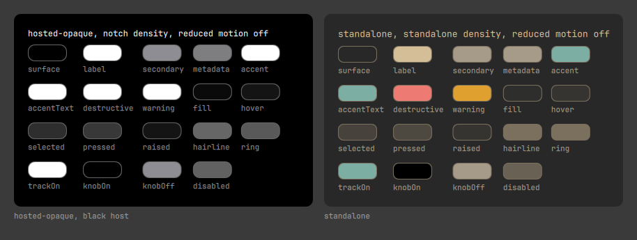

`ui/UTheme.qml`. Not a widget and not a singleton (a singleton cannot see a plugin's `surfaceHost`). One per plugin root; it decides the mode, the colours, the type, the sizes and the motion that every other component reads. The picture shows the colour roles it hands out in each mode.

```qml
import "ui"

Item {
  UTheme { id: theme; host: surfaceHost }   // host: null in a standalone window
  UButton { theme: theme; text: "Done" }
}
```

| Property | Type | Default | Notes |
|---|---|---|---|
| `host` | var | `null` | A `surfaceHost`-shaped object; `null` means standalone |
| `reducedOverride` | var | `undefined` | `true` or `false` forces reduced motion (tests, the gallery); undefined lets the host or the environment decide |

**Mode** (read-only): `hosted`, `styled`, `mode` (`"standalone"`, `"hosted-opaque"` or `"styled"`), `density` (`"notch"` when hosted, else `"standalone"`).

| Mode | `host` | Colours |
|---|---|---|
| standalone | null | Omarchy's palette (`Commons.Color`), alpha fills |
| hosted-opaque | set, `host.styled` not true (contract 1) | only what the host hands over: `color`, `foreground`, `secondary`, `accent`; every colour a computed solid |
| styled | `host.styled === true` (contract 2) | the kit's own roles and alpha fills over the host's surface; if the host's guard turns `styled` off, the same bindings give hosted-opaque |

**What it reads from `host`**: `color`, `foreground`, `secondary`, `accent`, `warning` (optional), `radiusFor(size)` or `radius`, `fontFamily`, `styled` (optional), `reducedMotion` (optional).

**Colour roles** (`color`, read-only, all computed by `tokens.js` `roles()`): `surface`, `label`, `secondary`, `metadata`, `accent` (the mark colour, 3:1), `accentText` (4.5:1), `destructive`, `warning`, `fill`, `hover`, `selected`, `pressed`, `raised` (level 2, a solid colour in every mode), `hairline`, `ring` (the focus ring), `trackOn`, `knobOn`, `trackOff`, `knobOff`, `disabled`, `none` (transparent). `roles` is the raw object, `pairs` and `palette` (`{pairs}`) list every text and mark pair for a plugin's own contrast check.

**Type**: `fontFamily` (one family), `bodySize`, `titleSize`, `footnoteSize` (none under 11 px), `headlineWeight` and `titleWeight` (DemiBold), `metadataWeight` (Light; a face without it shows Regular). Three text levels: primary `label`, secondary `secondary`, metadata `metadata`.

**Size**: `minHit` (24), `rowHeight` (30 notch, 32 standalone, never less than the body plus two `sp.sm`), `controlHeight` (`rowHeight - 4`), `switchWidth` and `switchHeight` (42 by 22), `hairlineWidth` (1), `tipMax` (60). `radius(h)` is the host's radius capped at half of `h`; `space(n)` is Omarchy's `Style.space(n)`; **`sp`** is the named spacing scale: `sp.xs` 4, `sp.sm` 8, `sp.md` 12, `sp.lg` 16, `sp.xl` 24, `sp.xxl` 32, each through `space()`.

**Motion**: `arriveCurve`, `controlCurve`, `celebrateCurve` (Bezier points for `easing.bezierCurve`), `arriveMs`, `controlMs`, `celebrateMs`, `exitMs`, `fadeOutMs`, `fadeInMs`, `focusMs`, `pressScale`, `pressMs`, `ringMs`, `staggerDelay(i)`. `reduced` and `envReduced` say whether reduced motion is on and whether the environment asked for it.

**`foot`** (string, writable): the one line a `placement: "foot"` tip writes to and a `line: true` tip shows.

Used by: everything. `UTheme` is the only file that imports `qs.Commons` and Quickshell.

---

## UKeys

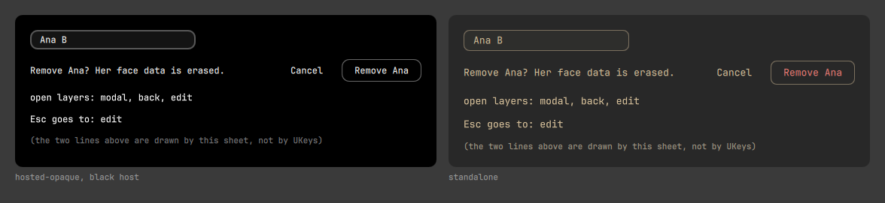

`ui/UKeys.qml`. A `FocusScope`; draws nothing. The one place Esc is handled: outside `ui/` there is no `Key_Escape` and no `onEscapePressed` (the gate fails it). Every layer joins one registry (`keys.js`), and the page-level `UKeys`, the one with focus, routes Esc to the top open layer. The picture is a `UField` with an unsaved edit and a `UConfirmSheet` asking; the two lines of text under them are drawn by the sheet from the registry, not by `UKeys`.

Esc goes, in order: `edit` (a field with an unsaved change), `tip`, `pick` (an open `UPick`), `modal` (a confirm), `back`, then `closeRequested`.

```qml
UKeys {                                  // once, around the page
  anchors.fill: parent
  focus: true
  level: "back"
  open: depth > 0                         // is there a step to go back to?
  onEscaped: goBack()                     // Esc landed on "back"
  onCloseRequested: root.closeRequested() // Esc with nothing open: leave the panel
  onPrimary: save.clicked()               // Enter nothing under the focus took
  // ...the page...
}
```

| Property | Type | Default | Notes |
|---|---|---|---|
| `level` | string | `"back"` | `"edit"`, `"tip"`, `"pick"`, `"modal"` or `"back"` (named `level` because `layer` is an Item's own property) |
| `open` | bool | `false` | Whether this level is open now: a tip showing, a pick expanded, a confirm asking, a page deeper than the root |
| `content` | default alias | | The children |

| Signal | When |
|---|---|
| `escaped()` | Esc landed on this level |
| `closeRequested()` | Esc with no layer open anywhere |
| `primary()` | Enter or Return that nothing under the focus handled |

The kit's own parts (`UTip`, `UPick`, `UField`, `UConfirmSheet`) join with their own level and need no wiring. A plugin makes one `UKeys` with `level: "back"` around its page, and one per extra layer it owns (a prompt that blocks the page is `level: "modal"`).

---

## UBack

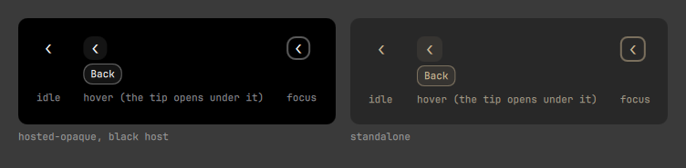

`ui/UBack.qml`. The chevron `‹` left of a page title. Under the notch the back step is the strip at the top centre of every panel, so draw this **only when the host has no such strip** (`host.features` lacks `panelBack`). Esc is not handled here; `UKeys` goes back one step.

```qml
UBack { theme: theme; visible: !hostHasBack; onActivated: goBack() }   // hostHasBack: your own check of surfaceHost.features
```

| Property | Type | Default | Notes |
|---|---|---|---|
| `hot`, `down`, `showFocus` | bool | the real state | state inputs |

Signal: `activated()`. Size: `controlHeight` square. Accessible name and tooltip: "Back". Keys: Enter, Return, Space. Roles: `hover`, `pressed`, `ring`, `label`.

---

## UClose

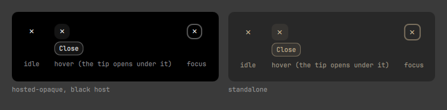

`ui/UClose.qml`. The one close: `✕` at the top right of a header. A window closes through this or Esc. A cross on a chip or a row removes that item and is not this component.

```qml
UClose { theme: theme; onActivated: root.closeRequested() }
```

Same shape as `UBack`: `hot`, `down`, `showFocus`; signal `activated()`; accessible name and tooltip "Close". Roles: `hover`, `pressed`, `ring`, `label`.

---

## USection

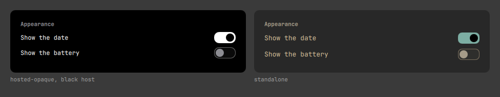

`ui/USection.qml`. A section header (a footnote in `secondary`, semibold) with `sp.xl` of air above it and no rule; the rows go inside. It is a `Column`.

```qml
USection {
  theme: theme
  title: "Appearance"
  first: true                      // the first section of a page has no gap above
  URow { theme: theme; label: "Show the date"; USwitch { theme: theme; label: "Show the date"; checked: on; onToggled: on = !on } }
}
```

| Property | Type | Default | Notes |
|---|---|---|---|
| `title` | string | `""` | The header text; it is a heading to a screen reader |
| `first` | bool | `false` | No top padding when true |
| `content` | default alias | | The children, in a column under the title |

Roles: `secondary`; spacing `sp.xl`, `sp.xs`.

---

## UButton

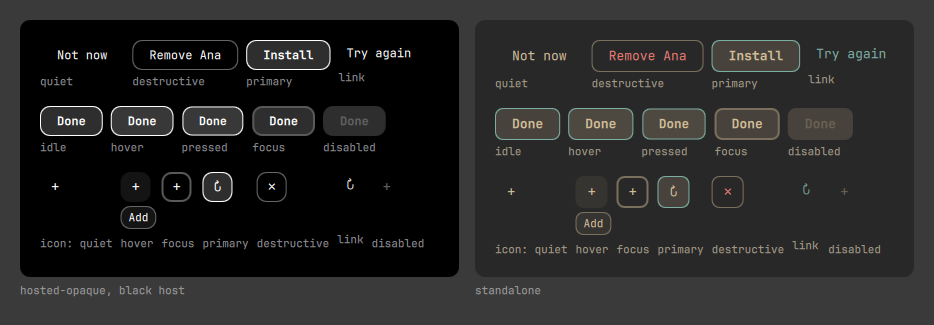

`ui/UButton.qml`. The one button. Four kinds, one word each, and an icon-only form (below); there is no second button class.

| `kind` | Use | Look |
|---|---|---|
| `quiet` (default) | the secondary action, left of the primary | no fill until hover |
| `primary` | at most one per surface, trailing edge | the selected fill and an accent outline (so it never reads by colour alone), semibold |
| `destructive` | verb plus object, last in the row, never the default | the quiet shape with a hairline; red only where the panel owns its colours |
| `link` | the `flow` variant of full-screen flows | accent text, no shape; underlined on hover |

Dismiss words are three: **Cancel**, **Done**, **Not now**; anything else is a verb and an object ("Remove Ana", "Install Face ID"). `dev/check-ui.sh` fails "Close", "Keep", "Later", "Dismiss", "OK", "Okay".

```qml
Row {
  spacing: theme.sp.sm
  UButton { theme: theme; text: "Cancel"; onClicked: close() }
  UButton { theme: theme; text: "Remove Ana"; kind: "destructive"; onClicked: confirm.ask() }
  UButton { theme: theme; text: "Done"; kind: "primary"; tip: "Saves and closes."; onClicked: save() }
}
```

| Property | Type | Default | Notes |
|---|---|---|---|
| `text` | string | `""` | The label, and the accessible name |
| `glyph` | string | `""` | Icon-only form: this mark is drawn instead of `text` |
| `name` | string | `""` | Icon-only form: the accessible name and the tooltip, required with `glyph` (a warning without); never drawn |
| `kind` | string | `"quiet"` | `"quiet"`, `"primary"`, `"destructive"`, `"link"` |
| `finishes` | bool | `false` | The one that finishes a flow: semibold. A page-level `UKeys.onPrimary` can call `clicked()` on it |
| `tip` | string | `""` | A float tip, at most 60 characters |
| `hot`, `down`, `showFocus` | bool | the real state | state inputs |
| `isLink`, `isPrimary`, `isDestructive`, `iconOnly` | bool | | read-only |

**Icon-only form.** For a row of actions that cannot each carry a word (add, refresh, share, remove) set `glyph`; it is the same button, so `kind`, `enabled`, `hot`/`down`/`showFocus`, the focus ring, the selected fill and accent outline of a primary, the red-capable destructive ink and the press all work as above, and there is no separate class to fail the gate. The mark is one character of the theme's font (or a Nerd Font glyph, which the walk still holds to 4.5:1 and 11 px) at `titleSize`. `name` is what a screen reader says and the tooltip (a longer `tip` replaces it), so it is a verb or noun, not "icon": "Add", "Refresh", "Remove Ana". The button is a square as tall as a text button (`rowHeight`, `controlHeight` for a `link`), never under 24 px, and it is one tab stop, so a row of six is six stops; a destructive one still goes through [`UConfirmSheet`](#uconfirmsheet). Keep an action that has a word as a text button: a glyph alone is for marks people already read (`+`, `↻`, `✕`), and `UClose` and `UBack` stay the one close and back.

```qml
Row {
  spacing: theme.sp.xs
  UButton { theme: theme; glyph: "+"; name: "Add"; onClicked: add() }
  UButton { theme: theme; glyph: "\u21bb"; name: "Refresh"; kind: "primary"; onClicked: refresh() }
  UButton { theme: theme; glyph: "\u2715"; name: "Remove Ana"; kind: "destructive"; onClicked: confirm.ask() }
}
```

Signal: `clicked()`. Height: `rowHeight` (a `link` is `controlHeight`); width: label plus `2 * sp.lg` (`2 * sp.sm` for a link), never under 24 px. Disabled (`enabled: false`) draws `disabled` and is not a tab stop. Press scales to 0.97 over 60 ms (off under reduced motion). Keys: Enter, Return, Space. Roles: `label`, `hover`, `pressed`, `selected`, `accent`, `accentText`, `destructive`, `hairline`, `ring`, `disabled`.

---

## URow

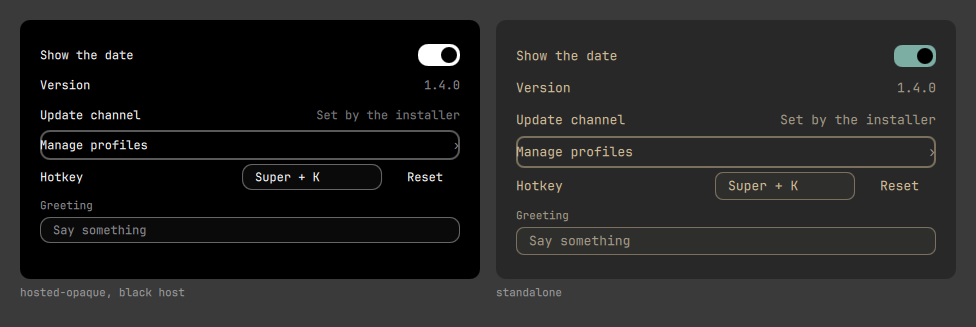

`ui/URow.qml`. One row: the label on the left, a value or a control on the right, an optional trailing slot, height by density. Its first child goes to the control slot.

| `variant` | Layout |
|---|---|
| `row` (default) | label left, control right, `rowHeight` tall |
| `stacked` | the label on its own line (secondary footnote), the control below it at full width |

```qml
URow { theme: theme; label: "Version"; value: "1.4.0" }
URow { theme: theme; label: "Update channel"; value: "Set by the installer"; valueQuiet: true }
URow { theme: theme; label: "Manage profiles"; value: "›"; clickable: true; onActivated: openProfiles() }
URow {
  theme: theme
  label: "Hotkey"
  trailing: UButton { theme: theme; text: "Reset" }
  UField { theme: theme; label: "Hotkey"; value: key; width: 140 }
}
URow { theme: theme; variant: "stacked"; label: "Greeting"; UField { theme: theme; width: parent.width; label: "Greeting" } }
```

A state that cannot be changed is a `value` on the right ("Set by the installer"), never a disabled switch. Explanation is pulled, not printed: use `tip`.

| Property | Type | Default | Notes |
|---|---|---|---|
| `label` | string | `""` | |
| `value` | string | `""` | read-only text on the right |
| `valueQuiet` | bool | `false` | the value is small print: metadata (quieter, Light), not secondary |
| `variant` | string | `"row"` | `"row"` or `"stacked"` |
| `tip` | string | `""` | float tip |
| `clickable` | bool | `false` | the row is itself the control: hover, focus ring, a name, one tab stop |
| `control` | default alias | | the control slot |
| `trailing` | alias | | a second slot after it (buttons, a job) |
| `hot`, `showFocus` | bool | the real state | state inputs |
| `stacked`, `gap` | | | read-only |

Signal: `activated()` (a `clickable` row). Width: the parent's width, else 320. Keys on a `clickable` row: Enter, Return, Space. Roles: `label`, `secondary`, `metadata`, `disabled`, `hover`, `pressed`, `ring`.

---

## USwitch

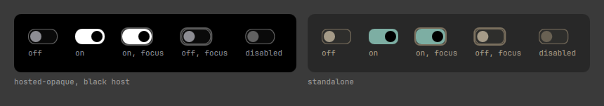

`ui/USwitch.qml`. The one switch: a 22 by 42 track in a 24 px hit target. Two-option choices are switches. It lives in a `URow`, which supplies the visible label; `label` here is the accessible name.

```qml
URow { theme: theme; label: "Show the date"
  USwitch { theme: theme; label: "Show the date"; checked: showDate; onToggled: showDate = !showDate } }
```

| Property | Type | Default | Notes |
|---|---|---|---|
| `label` | string | `""` | the accessible name |
| `checked` | bool | `false` | the owner flips it |
| `tip` | string | `""` | float tip |
| `hot`, `down`, `showFocus` | bool | the real state | state inputs |

Signal: `toggled()`: the user asked for the other state. Keys: Enter, Return, Space. The knob slides on the `control` spring. Roles: `trackOn`, `knobOn`, `trackOff`, `knobOff`, `hairline`, `ring`, `disabled`.

---

## USegmented

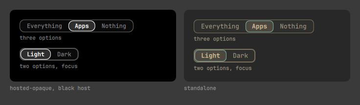

`ui/USegmented.qml`. Two to four options on one line (more is a `UPick`; it logs a warning otherwise). One tab stop. The chosen segment shows as a fill, an accent outline and semibold, so it never rests on colour alone.

```qml
USegmented {
  theme: theme
  label: "Scope"
  value: scope
  options: [{ value: "all", label: "Everything" }, { value: "apps", label: "Apps" }, { value: "none", label: "Nothing" }]
  onPicked: function(v) { scope = v }
}
```

| Property | Type | Default | Notes |
|---|---|---|---|
| `options` | var | `[]` | `[{value, label}, ...]` |
| `value` | string | `""` | the chosen `value` |
| `label` | string | `"Options"` | the accessible name of the group |
| `tip` | string | `""` | float tip |
| `showFocus` | bool | `activeFocus` | state input |
| `index` | int | | read-only: the chosen option's index, or -1 |

Signal: `picked(string value)`. Keys: Left and Right move the choice and emit `picked` (the end of the row stops, it does not wrap). Segments are at least 24 px wide. Roles: `fill`, `hairline`, `selected`, `accent`, `hover`, `label`, `secondary`, `ring`, `disabled`.

---

## UPick

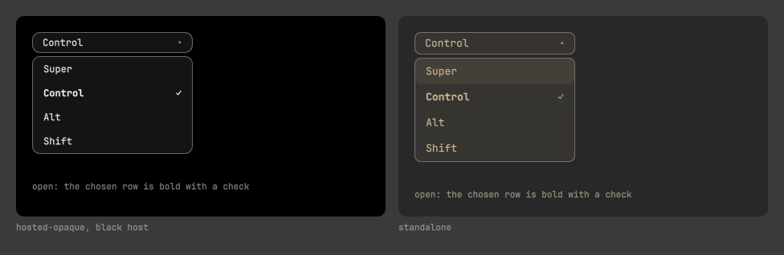

`ui/UPick.qml`. Three or more options, or long ones. Opens a list under the control, drawn over its siblings (`z` 1000 while open) and not in a popup, so it stays inside a notch panel and clips with it. The list is a solid `raised` box with a hairline; the chosen row is semibold with a `✓`.

```qml
UPick {
  theme: theme
  label: "Modifier"
  value: modifier
  options: [{ value: "super", label: "Super" }, { value: "ctrl", label: "Control" }, { value: "alt", label: "Alt" }]
  onPicked: function(v) { modifier = v }
}
```

| Property | Type | Default | Notes |
|---|---|---|---|
| `options` | var | `[]` | `[{value, label}, ...]` |
| `value` | string | `""` | |
| `label` | string | `""` | the accessible name (a combo box) |
| `tip` | string | `""` | float tip, off while open |
| `open` | bool | `false` | settable |
| `cursor` | int | `-1` | the highlighted row while open |
| `hot`, `showFocus` | bool | the real state | state inputs |
| `index`, `shown` | | | read-only: the chosen index and its label |

Signal: `picked(string value)`; function `choose(i)`. Keys: see the table above. Esc closes (the `pick` level); picking a row or leaving the control closes it too. Roles: `fill`, `hover`, `hairline`, `raised`, `label`, `secondary`, `accentText`, `ring`, `disabled`.

---

## UField

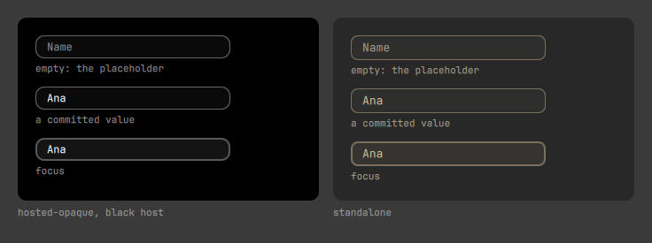

`ui/UField.qml`. One line of text. Enter commits; Esc reverts to the last committed value (while there is an unsaved change and the field has focus, Esc is the field's and the panel does not close).

```qml
UField { theme: theme; label: "Name"; placeholder: "Name"; value: saved; onCommitted: function(t) { saved = t } }
UField { theme: theme; label: "Password"; secret: true; onCommitted: function(t) { unlock(t); clear() } }
```

**`secret: true`** is the masked field for a password prompt. The text is drawn as bullets (`echoMode: Password`, mask delay 0, so not even the last character shows), the input method gets `ImhSensitiveData | ImhNoPredictiveText | ImhNoAutoUppercase | ImhHiddenText` (no predictive text, no history), and the accessible name is `label`, never the text. Nothing in the field puts the text in a tooltip or a description; the `tip` is the plugin's own string.

Esc differs, on purpose: a plain field with an unsaved edit keeps the first Esc to revert it, but a secret field never joins the `edit` layer, so the first Esc is the next layer's (a confirm, the prompt's own `modal`, the page's back) and a half-typed secret does not outlive the person's cancel. The field does not wipe itself when Esc lands elsewhere: the owner calls `clear()` when it closes the prompt, and after it has used the text. Leave `value` empty for a secret; `committed(text)` is the only way the text leaves, and the owner should hand it on (stdin, not a property) and not store it.

| Property | Type | Default | Notes |
|---|---|---|---|
| `label` | string | `""` | the accessible name, and the placeholder when `placeholder` is empty |
| `placeholder` | string | `""` | shown when empty and unfocused |
| `value` | string | `""` | the committed text; the owner updates it from `committed` |
| `tip` | string | `""` | float tip, on the text input |
| `secret` | bool | `false` | masked, no predictive text; Esc cancels at once (see above) |
| `input` | alias | | the inner `TextInput` (focus, `text`, `inputMethodHints`) |
| `hot`, `showFocus` | bool | the real state | state inputs |
| `dirty` | bool | | read-only: the text differs from `value` |

Signal: `committed(string text)`. Function: `clear()` (wipe the typed text). Width 200 and `controlHeight` by default; set `width` for more. Roles: `fill`, `hover`, `hairline`, `ring`, `label`, `secondary`, `disabled`, `accent` (selection).

---

## UStepper

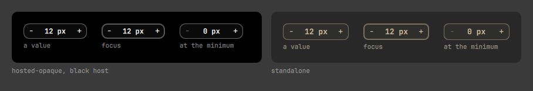

`ui/UStepper.qml`. A number with a minus and a plus. One tab stop, Left and Right step it. It has no typed entry. It asks (`modified(next)`) and the owner sets `value`.

```qml
UStepper { theme: theme; label: "Corner radius"; from: 0; to: 40; value: radius; unit: " px"; onModified: function(v) { radius = v } }
```

| Property | Type | Default | Notes |
|---|---|---|---|
| `label` | string | `""` | the accessible name (with the value) |
| `value` | int | `0` | |
| `from`, `to` | int | `0`, `100` | the range, inclusive; the stepper stops at the ends |
| `stepSize` | int | `1` | |
| `unit` | string | `""` | shown after the number: `" px"` |
| `tip` | string | `""` | float tip |
| `showFocus`, `hotMinus`, `hotPlus` | bool | the real state | state inputs |

Signal: `modified(int value)`. Function: `nudge(direction)` (`1` or `-1`). Keys: Left and Right. Roles: `fill`, `hairline`, `hover`, `pressed`, `ring`, `label`, `disabled`.

---

## UTip

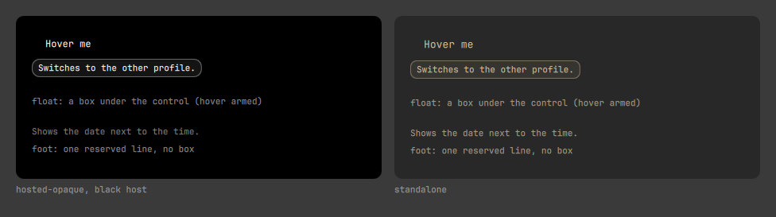

`ui/UTip.qml`. The tip: a footnote that appears 400 ms after hover or 250 ms after keyboard focus, at most 60 characters (a longer one logs a warning), effect first, no repeat of the label. It is declared as a child of the control it explains and reads that control's `hot` and `activeFocus`. Esc dismisses it before anything else.

| `placement` | Look |
|---|---|
| `float` (default) | a small solid box under the control: `raised` with a hairline. A child of its control, so any ancestor that clips will clip it |
| `foot` | no box: the text goes to `theme.foot`, which one reserved `UTip { line: true }` at the bottom of the page shows, metadata colour, one line |

The `tip:` property of the kit's controls is always `float`. For the notch declare the tip yourself, and put one line on the page:

```qml
UStepper {
  theme: theme; label: "Radius"; from: 0; to: 120; value: radius
  UTip { theme: theme; text: "← → change the radius"; placement: "foot" }   // goes to theme.foot while shown
}
// ...at the foot of the page, once:
UTip { theme: theme; width: page.width; line: true }
```

| Property | Type | Default | Notes |
|---|---|---|---|
| `text` | string | `""` | |
| `placement` | string | `"float"` | `"float"` or `"foot"` |
| `line` | bool | `false` | this is the reserved foot line itself (one line tall) |
| `target` | Item | `parent` | whose `activeFocus` arms the focus timer |
| `owner` | var | `parent` | whose `hot` arms the hover timer; for something that is not a kit control set `hovering` yourself |
| `hovering` | bool | `owner.hot` | |
| `armedHover`, `armedFocus`, `dismissed` | bool | `false` | the timers' state; the gallery sets `armedHover` to draw a tip without a pointer |
| `focused`, `shown` | bool | | read-only |

Roles: `raised`, `hairline`, `label` (float), `metadata` (foot), `fadeInMs` and `fadeOutMs`.

---

## UToast

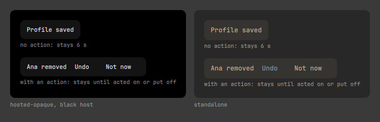

`ui/UToast.qml`. The one toast: a line on a raised, solid box, with at most one action and "Not now" to put it off. With an action it stays until acted on or put off; without one it stays 6 s, paused while the pointer is over it or one of its buttons has focus. The acknowledgement of an action is this, or the same line in secondary inline; never a 3 s note that is the only sign anything happened. It has no tones; use [`UNotice`](#unotice) for a state. The owner positions it.

```qml
UToast { id: toast; theme: theme; onActed: undo() }
// then:
toast.show("Profile saved")
toast.show("Ana removed", "Undo")
```

| Property | Type | Default | Notes |
|---|---|---|---|
| `text`, `actionText` | string | `""` | set by `show()` |
| `shown` | bool | `false` | |
| `paused` | bool | | read-only |

Signals: `acted()` (the action was pressed; the toast hides), `dismissed()` ("Not now", or the 6 s ended). Functions: `show(line, actionLabel)` and `hide()`. It arrives on the `arrive` spring and leaves on a short ease; under reduced motion only the fade remains. Roles: `raised`, `label`.

---

## UNotice

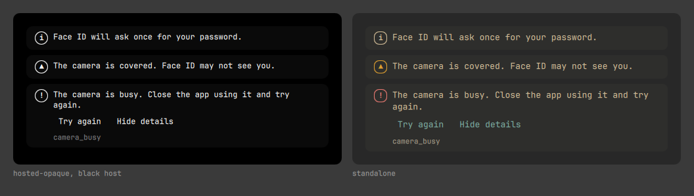

`ui/UNotice.qml`. An inline notice: what happened and what to do, in one place on the page. The sentence comes from the plugin's own table (`errors.js`); an unknown code reads "Something went wrong." and the code appears only under Details. A code never reaches the surface any other way. The mark is a glyph in a ring and a screen reader hears the word, so the state never rests on colour alone.

| `tone` | Mark | Colour | Spoken |
|---|---|---|---|
| `info` | `i` | `label` | |
| `warning` | `▲` | `warning` (amber; the label in a hosted-opaque panel with none handed over) | "Warning: " |
| `error` (default) | `!` | `destructive` (red; the label in hosted-opaque) | "Error: " |

`"warn"` is the old name of `"error"` and still reads as it.

```qml
UNotice {
  theme: theme
  width: page.width
  text: errors.message(code)
  details: errors.details(code)
  actionText: "Try again"
  onActed: retry()
}
UNotice { theme: theme; width: page.width; tone: "warning"; text: "The camera is covered. Face ID may not see you." }
```

| Property | Type | Default | Notes |
|---|---|---|---|
| `tone` | string | `"error"` | `"info"`, `"warning"`, `"error"` (`"warn"` reads as `error`) |
| `text` | string | `""` | |
| `details` | string | `""` | the code; a "Details" link shows it |
| `actionText` | string | `""` | one recovery verb, "Try again", or empty |
| `showDetails` | bool | `false` | |
| `kind`, `ink`, `glyph` | | | read-only |

Signal: `acted()`. Width 360 by default; set `width`. Roles: `fill`, `label`, `destructive`, `warning`, `metadata`, and the link buttons' `accentText`.

---

## UEmpty

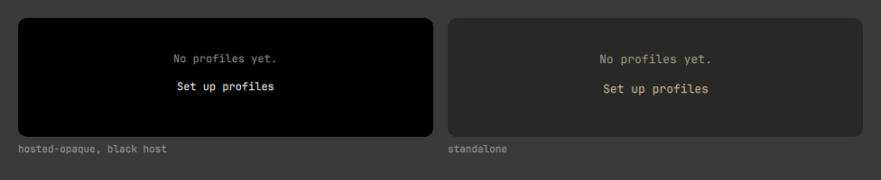

`ui/UEmpty.qml`. The empty state: one sentence and at most one action, centred.

```qml
UEmpty { theme: theme; width: page.width; text: "No profiles yet."; actionText: "Set up profiles"; onActed: setup() }
```

| Property | Type | Default | Notes |
|---|---|---|---|
| `text` | string | `""` | in `secondary` |
| `actionText` | string | `""` | hides the button when empty |

Signal: `acted()`. Width 320 by default. Roles: `secondary`, and a `UButton`'s.

---

## URing

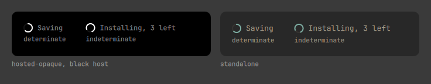

`ui/URing.qml`. Progress: a ring, 16 px beside a label. A bar is only for live values (the OSD).

```qml
URing { theme: theme; value: 0.62; text: "Saving" }        // determinate
URing { theme: theme; text: "Installing, 3 left" }          // indeterminate: value is -1
```

| Property | Type | Default | Notes |
|---|---|---|---|
| `value` | real | `-1` | 0 to 1 is determinate; `-1` is indeterminate |
| `text` | string | `""` | beside the ring; the accessible name (else "Working") |
| `size` | int | `16` | |
| `indeterminate` | bool | | read-only |

Indeterminate is a 270 degree arc turning once every 900 ms, linear. Under reduced motion it stops and shows a steady half arc. The track carries no information, so it is not a mark; the arc is (3:1). Roles: `accent`, `hover` (the track), `secondary`.

---

## UConfirmSheet

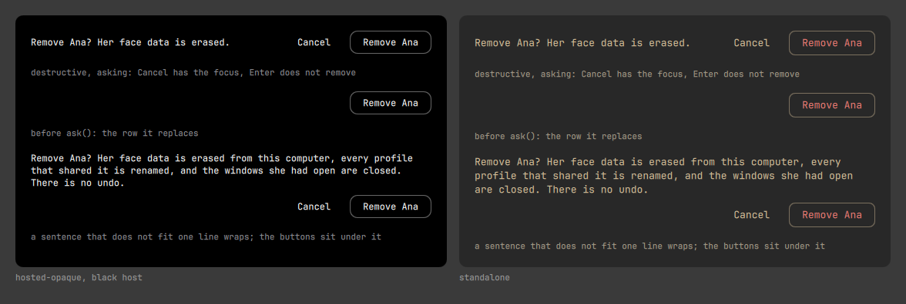

`ui/UConfirmSheet.qml`. The confirm: an inline row, never an overlay or a window. It replaces the action row it belongs to, in place: one sentence naming the consequence ("Remove Ana? Her face data is erased."), then Cancel and the verb. The slot is as tall as the larger of the two states, so nothing around it moves; the swap is a 90 ms fade. Esc is Cancel.

**The sentence wraps** (there is no 60-character cap since 1.1). There are two layouts, chosen by whether the sentence fits one line beside the buttons: if it does, it sits left of them and the sheet is one row high, as before; if not (`stacked`), it wraps over the full width and Cancel and the verb sit right-aligned on a line of their own under it, so the sheet is the wrapped text plus one row. Nothing is cut with an ellipsis any more: in 1.0 a sentence too long for the room beside the buttons was elided. Past 400 characters (`sentenceMax`) the sheet logs a warning: a consequence that long wants a shorter sentence and a [`UNotice`](#unotice) for the rest. The focus rule is unchanged: with `destructive` Cancel has the initial focus in either layout, and Tab goes Cancel then the verb.

A **destructive** verb is never the default: Cancel takes the focus and Enter does not fire the verb. Any other verb takes the focus, so Enter confirms.

```qml
UConfirmSheet {
  id: confirm
  theme: theme
  width: page.width
  sentence: "Remove Ana? Her face data is erased."
  verb: "Remove Ana"
  destructive: true
  onConfirmed: remove()
  UButton { theme: theme; text: "Remove Ana"; kind: "destructive"; anchors.right: parent.right; onClicked: confirm.ask() }   // the row it replaces
}
```

| Property | Type | Default | Notes |
|---|---|---|---|
| `sentence` | string | `""` | wraps; over 400 characters logs a warning |
| `verb` | string | `""` | the confirm button's label |
| `destructive` | bool | `false` | red-capable `destructive` button, Cancel has the focus |
| `asking` | bool | `false` | true shows the question |
| `actions` | default alias | | the row it replaces, shown until `ask()` |
| `stacked`, `sentenceMax` | | | read-only: the sentence is on its own lines above the buttons; the 400-character soft limit |

Signals: `confirmed()`, `cancelled()`. Functions: `ask()`, `cancel()`, `confirm()`. Roles: `label` and the two `UButton`s'.

---

## The JavaScript libraries

Pure functions with no Qt, one instance each (`.pragma library`), tested in node (`dev/tests/*.mjs`).

| File | What | Public |
|---|---|---|
| `tokens.js` | every colour role for the three modes, the spacing scale, motion and density tokens | `MAJOR`, `SPACING`, `MOTION`, `ALPHA`, `DENSITY`, `roles(p)`, `pairs(r)`, `check(r)`, `contrast`, `lift`, `reducedFrom(env)`, `radius`, `staggerDelay` and the colour helpers |
| `keys.js` | the key map and the Esc registry | `action(role, key)`, `step`, `LAYERS`, `escapeTarget(open)`, `createRegistry()`, `shared` |
| `spring.js` | the sampled spring curve | `curve(damping, peakAt, segments)`, `overshoot(damping)` |
| `errors.js` | one error table per plugin | `create({sentences, exits, notes, fallback})` returning `message`, `details`, `note`, `forResult` |

```qml
import "ui/errors.js" as Errors

QtObject {
  readonly property var errors: Errors.create({
    sentences: { camera_busy: "The camera is busy. Close the app using it and try again." },
    exits: { 126: "Permission declined" }
  })
  // errors.message("camera_busy")  the sentence
  // errors.message("zzz")          "Something went wrong." (a code the table has never heard of)
  // errors.details("camera_busy")  "camera_busy": for the Details line of a UNotice, and nowhere else
}
```
